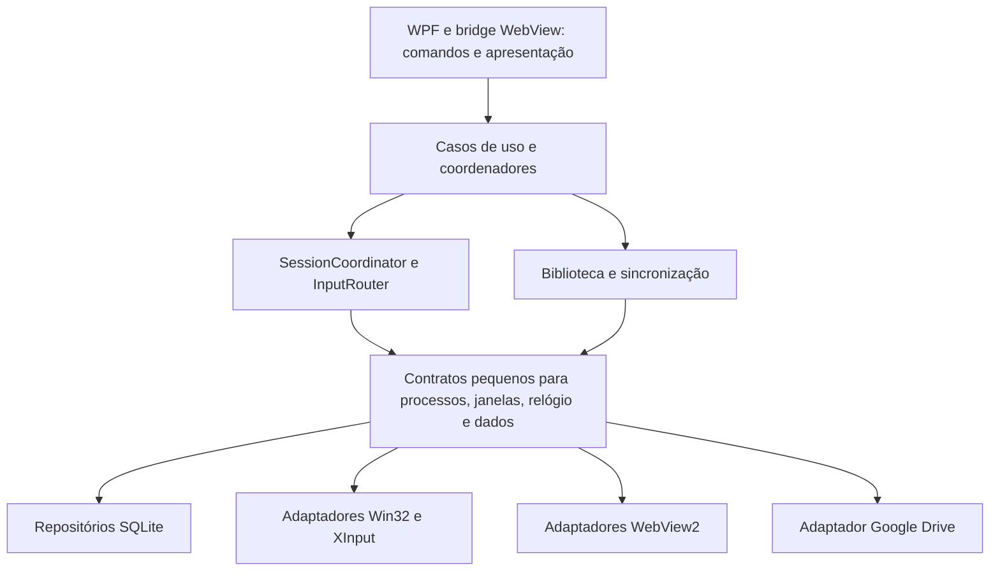

# Auditoria de robustez, armazenamento e arquitetura do Doorpi

Data: 8 de novembro de 2026. Base: árvore de trabalho local, incluindo as alterações ainda não commitadas que já existiam ao iniciar a análise.

## Parecer

**O back-end atual não está bem estruturado para a responsabilidade central do produto: administrar sessões, processos e entrada de maneira previsível. Eu não aprovaria sua arquitetura atual como uma base robusta sem corrigir os problemas P1 abaixo.** A aplicação tem recursos e algumas boas proteções, mas depende excessivamente de estado global mutável, heurísticas de processos, persistência espalhada e coordenação implícita entre tarefas.

Recomendo **SQLite local para o estado persistente**, com uma extração gradual das regras de sessão e entrada para componentes independentes de WPF. A migração é justificada principalmente por integridade e transações; os ganhos de desempenho também são plausíveis pelos padrões de acesso encontrados, mas não foram medidos em uma carga real.

Trocar `File.WriteAllText` por `INSERT` dentro dos mesmos métodos não resolveria os principais defeitos. Continuariam existindo usuário de destino mutável, callbacks obsoletos, decisões incorretas de encerramento e perda de posse das teclas.

### Avaliação por responsabilidade

| Responsabilidade | Parecer | Evidência principal |
| --- | --- | --- |
| Separação de responsabilidades | Inadequada | 29 arquivos `MainWindow*.cs`, 56.760 linhas físicas e cerca de 2,55 MB na mesma classe partial |
| Integridade entre dados relacionados | Insuficiente | Biblioteca, histórico, espelhos, controles e sync são gravados em operações independentes |
| Isolamento entre usuários | Falha | Downloads e aplicação de controles da nuvem podem usar o perfil que estiver ativo no commit |
| Sessões e restauração | Frágil | Adoção de processo ambíguo, relógio reiniciado na restauração e ausência de liveness quando minimizado |
| Engine de controles | Falha em transições | Três defeitos reproduzidos sem WPF: tecla presa, liberação compartilhada e conflito de chord |
| Durabilidade de um arquivo | Boa base, aplicação desigual | `DurableFileStore` faz temporário, flush e substituição; não oferece transação entre arquivos |
| Recuperação | Parcial | Há supervisor e journal, mas a retomada não reconstrói integralmente uma sessão externa viva |
| Testabilidade | Muito concentrada em boot/browser | Os testes existentes passam; as reproduções adicionais encontraram falhas fora dessa cobertura |

`partial` organiza arquivos. Não cria encapsulamento, ownership de estado, isolamento de dependências ou fronteiras de domínio. Neste caso, boa parte da modularização atual é física, não arquitetural.

## Método e limites

- Revisão do código atual de persistência, perfis, sessões, processos, janelas, controles, varredura de bibliotecas, WebView e sincronização.
- Build Release completo da solução; execução das suítes existentes de boot e permissões e dos scripts relevantes do frontend/RPCS3.
- Experimentos isolados com métodos atuais de armazenamento e controles, além da engine atual de merge de perfis e do enumerador de arquivos.
- Não iniciei o Doorpi nem jogos reais, não injetei entrada no Windows e não abri os arquivos pessoais de dados do usuário.
- Não realizei profiling de CPU/memória, benchmark JSON versus SQLite ou teste real de corte de energia. Custos de desempenho abaixo são estruturais; não representam percentuais medidos.
- Os experimentos de armazenamento isolam roteamento e concorrência: `MergeGamesWithHistory` foi explicitamente substituído por um no-op. Os de controles registram saídas em vez de chamar Win32. O teste de sync simula a interrupção entre etapas, sem Google Drive real.
- Updater, helpers, instalador e segurança completa do bridge não receberam uma auditoria exaustiva. Compilar não demonstra correção funcional desses componentes.

**Classificação:** P1 = perda/mistura de dados, exposição de dados ou controle incorreto de processos; P2 = falha funcional relevante ou risco de recuperação/concorrência. “Reproduzido” significa experimento isolado; “confirmado no fluxo” significa encadeamento verificável no código, sem reprodução interativa; “risco” identifica um interleaving ainda não executado.

## Achados

### A01 — P1: a pasta inteira de dados é publicada no navegador externo

**Confirmado no fluxo e na documentação do SDK; sem exploração com dados reais.**

[MainWindow.WebApps.cs:7280](C:/_Projetos/Doorpi/Doorpi/MainWindow.WebApps.cs:7280) configura `data.local` apontando para `dataFolder` inteiro, com `CoreWebView2HostResourceAccessKind.Allow`, no WebView que abre conteúdo externo. Os handlers de navegação e recursos, em 7345 e 9190, não estabelecem uma restrição de acesso a essa raiz.

`Allow` permite inclusive `fetch`/XHR entre origens. Assim, uma página externa que não imponha uma CSP restritiva própria pode solicitar os JSONs locais. Isso expõe metadados de outros perfis e se agrava porque [ProfileSyncEngine.cs:40](C:/_Projetos/Doorpi/Doorpi/ProfileSync/ProfileSyncEngine.cs:40) inclui PIN e chave SteamGrid no snapshot, enquanto [ProfileSyncLocalStore.cs:96](C:/_Projetos/Doorpi/Doorpi/ProfileSync/ProfileSyncLocalStore.cs:96) e 236 gravam snapshots/base/backups sem proteção desses campos. A proteção DPAPI de outros arquivos não cobre automaticamente esses snapshots.

**Correção:** remover a raiz dos dados dos WebViews externos. Publicar apenas assets necessários em diretório separado e com política de origem mínima. Revisar também o acesso por navegação direta; `DenyCors` sozinho não transforma uma pasta sensível em conteúdo seguro. Separar credenciais de dados de perfil e proteger seu ciclo completo, incluindo cópias de sync. Mudar para SQLite mantendo o banco sob esse mapping continuaria expondo dados.

Referência primária: [Microsoft: CoreWebView2HostResourceAccessKind](https://learn.microsoft.com/en-us/dotnet/api/microsoft.web.webview2.core.corewebview2hostresourceaccesskind?view=webview2-dotnet-1.0.3856.49).

### A02 — P1: uma operação iniciada em A pode gravar no perfil B

**Roteamento reproduzido; caminho assíncrono confirmado no código.**

[MainWindow.Emulators.cs:1639](C:/_Projetos/Doorpi/Doorpi/MainWindow.Emulators.cs:1639) verifica o usuário antes do download e carrega sua biblioteca. Depois há `await` em 1655 e 1667, seguido de `SaveGames(currentGames)` em 1694. Esse método escreve usando o campo global `gamesFile`, alterado na troca de perfil: [MainWindow.xaml.cs:1996](C:/_Projetos/Doorpi/Doorpi/MainWindow.xaml.cs:1996) e [16220](C:/_Projetos/Doorpi/Doorpi/MainWindow.xaml.cs:16220).

O mesmo defeito de contexto aparece na aplicação cloud dos controles: [MainWindow.ProfileSync.cs:984](C:/_Projetos/Doorpi/Doorpi/MainWindow.ProfileSync.cs:984) chama `ApplyCloudControlConfiguration` fora da verificação do usuário corrente; o método carrega o documento atual e atribui `OwnerUserId=currentUserId` em [MainWindow.ControlConfiguration.cs:2836](C:/_Projetos/Doorpi/Doorpi/MainWindow.ControlConfiguration.cs:2836). Há esperas antes dessa aplicação, inclusive backup e atualização via Dispatcher.

**Cenário:** A inicia download/sync; usuário muda para B; a continuação usa listas de A com caminhos e ownership de B. O harness de armazenamento reproduziu B terminando com a biblioteca de A.

**Correção:** receber `UserContext(profileId, epoch, cancellationToken)` imutável e um repositório explicitamente vinculado ao proprietário. Cancelar trabalho de apresentação ao trocar usuário e rejeitar commits obsoletos dentro da operação serializada. `SaveGames(games)` sem usuário/versão explícitos é uma API inadequada nesse domínio.

### A03 — P1: locks separados de leitura e gravação não evitam perda de atualização

**Reproduzido com os métodos atuais de Load/Save.**

[MainWindow.xaml.cs:16220](C:/_Projetos/Doorpi/Doorpi/MainWindow.xaml.cs:16220) e 16231 protegem `SaveGames` e `LoadGames` individualmente. Não protegem o intervalo ler → aguardar → modificar → gravar usado em [MainWindow.xaml.cs:13769](C:/_Projetos/Doorpi/Doorpi/MainWindow.xaml.cs:13769) e [MainWindow.Emulators.cs:1642](C:/_Projetos/Doorpi/Doorpi/MainWindow.Emulators.cs:1642).

**Cenário reproduzido:** download captura a lista; outra operação adiciona um jogo e conclui a gravação; download salva sua lista antiga. O novo jogo desaparece. Atomicidade da substituição do arquivo não impede esse problema lógico.

**Correção:** atualizar somente os campos da entidade identificada, com transação curta e revisão otimista. Não manter transação/lock enquanto espera rede. Antes do commit, reler/validar a revisão e aplicar o patch, em vez de regravar o snapshot antigo.

### A04 — P1: recuperação pode copiar dados de outro usuário e ignorar backup válido

**Reproduzido.**

[MainWindow.xaml.cs:16235](C:/_Projetos/Doorpi/Doorpi/MainWindow.xaml.cs:16235) escolhe o espelho global quando o principal do usuário não existe, antes de tentar o `.bak` daquele usuário. Em 16257 aceita o espelho global após falha das cópias locais. Em 16269 grava os dados recuperados no perfil ativo. A cópia global não informa qual usuário a produziu.

**Cenário reproduzido:** existe backup válido de A, falta o principal de A e o espelho global contém B. `LoadGames()` retorna B e persiste B em A. Com principal e backup de A corrompidos, também importa B silenciosamente. [LoadFoldersData:11701](C:/_Projetos/Doorpi/Doorpi/MainWindow.xaml.cs:11701) tem fallback global semelhante.

**Correção:** eliminar espelhos como fonte de verdade. Até a migração, priorizar principal e backup do mesmo proprietário, registrar proveniência e isolar arquivos globais ambíguos. Não “recuperar” automaticamente de uma cópia sem ownership verificável.

### A05 — P1: varredura incompleta é interpretada como exclusão definitiva

**Truncamento reproduzido; remoção confirmada no fluxo.**

[MainWindow.Emulators.cs:294](C:/_Projetos/Doorpi/Doorpi/MainWindow.Emulators.cs:294) limita a enumeração a 6.000 arquivos de qualquer extensão e engole falhas de acesso. Em 1173 descarta raízes indisponíveis. A reconciliação em [1859](C:/_Projetos/Doorpi/Doorpi/MainWindow.Emulators.cs:1859) remove registros e chama `DeleteGameImages` para tudo que não reapareceu, persistindo a lista em 1920.

O experimento com 6.001 ROMs retornou exatamente 6.000, sem informar truncamento. Disco removível ausente, SMB temporariamente offline ou permissão negada também produz inventário incompleto.

**Correção:** retornar `ScanResult(items, completenessByRoot, errors, truncated)`. Exclusão só pode ser inferida em uma raiz completamente lida. Ausência temporária deve marcar indisponibilidade e preservar metadados/artes. Limites de trabalho devem gerar continuação/paginação, não um snapshot aparentemente completo.

### A06 — P1: uma sessão pode adotar e encerrar um processo independente

**Confirmado no fluxo; não executei encerramento de processos reais.**

[MainWindow.xaml.cs:4840](C:/_Projetos/Doorpi/Doorpi/MainWindow.xaml.cs:4840) chama `TryFindProtocolLaunchedMediaWindow` durante a expansão comum do grupo. Em [4873](C:/_Projetos/Doorpi/Doorpi/MainWindow.xaml.cs:4873), basta a janela pertencer a um PID fora do baseline e não estar em algumas exclusões. Não há prova de caminho, parentesco ou nome esperado. O candidato é incluído no grupo; [5043](C:/_Projetos/Doorpi/Doorpi/MainWindow.xaml.cs:5043) usa esse grupo no encerramento com `Kill(true)`.

**Cenário:** iniciar um app de mídia e depois abrir outro programa independente. A nova janela pode ser classificada como parte da sessão e sofrer foco, entrada ou encerramento indevidos. A expansão ocorre repetidamente, não apenas durante o lançamento.

**Correção:** representar identidade confirmada como PID + horário de criação + executável. Validar HWND contra essa identidade e comprovar relação antes da promoção. Candidato heurístico não pode ganhar autoridade de encerramento. Ausência no baseline não demonstra ownership.

### A07 — P1: restaurar o mesmo jogo pode reiniciar seu relógio

**Confirmado no fluxo.**

[MainWindow.xaml.cs:15426](C:/_Projetos/Doorpi/Doorpi/MainWindow.xaml.cs:15426) tenta `TryAdoptAlreadyRunningGame` antes de tratar `isSameGame` em 15454. A adoção encontra janelas de executáveis existentes e chama `StartActiveSessionClock(confirmed:true)` em 10886. Em [8863](C:/_Projetos/Doorpi/Doorpi/MainWindow.xaml.cs:8863), são zerados início, tempo-base, checkpoints e identificador de sessão.

**Cenário:** jogar, minimizar e clicar no card para restaurar o mesmo executável. O relógio anterior pode ser substituído sem consolidação do período transcorrido.

**Correção:** tratar restauração da sessão atual antes de adoção. Início de relógio deve ser idempotente por `session_id`; restaurar janela não cria sessão nova nem altera seu início.

### A08 — P1: jogo minimizado deixa de ser monitorado quanto ao encerramento

**Confirmado no fluxo dos jogos diretos e de loja.**

[MainWindow.xaml.cs:8601](C:/_Projetos/Doorpi/Doorpi/MainWindow.xaml.cs:8601) entra no ramo `_gameIsMinimized` e faz `continue` sem checar vida do processo. [MainWindow.Stores.cs:1461](C:/_Projetos/Doorpi/Doorpi/MainWindow.Stores.cs:1461) repete o comportamento. O journal continua calculando tempo enquanto a sessão permanece ativa.

**Cenário:** jogo minimizado fecha/crasha. Doorpi pode manter sessão pendente, bloquear novo jogo e acumular tempo inexistente.

**Correção:** separar descoberta de janela de liveness do processo. Minimizar pode reduzir trabalho de descoberta; não pode suspender a detecção de encerramento.

### A09 — P1: restaurar um aplicativo pode matá-lo automaticamente

**Confirmado no fluxo.**

[MainWindow.xaml.cs:5499](C:/_Projetos/Doorpi/Doorpi/MainWindow.xaml.cs:5499) tenta localizar janela por aproximadamente 2 segundos, relança e tenta por mais aproximadamente 3 segundos; em [5516](C:/_Projetos/Doorpi/Doorpi/MainWindow.xaml.cs:5516) mata a árvore e inicia novamente.

Processo vivo sem HWND reconhecido não é necessariamente processo travado. Aplicativo lento, em tray ou com janela não reconhecida pode perder trabalho não salvo durante uma ação apresentada como restauração.

**Correção:** separar `Restore`, `RetryDiscovery` e `Restart`. Reinício destrutivo exige decisão explícita na interface e identidade do alvo confirmada. Falha de descoberta deve retornar estado/error apropriado, não autorizar `Kill`.

### A10 — P2: abrir teclado virtual pode deixar tecla presa

**Reproduzido com a engine atual.**

[MainWindow.ControlConfiguration.cs:2183](C:/_Projetos/Doorpi/Doorpi/MainWindow.ControlConfiguration.cs:2183) remove o perfil do aplicativo das rotas quando o VKB está aberto, mas não reconcilia/libera saídas mantidas por rotas removidas. A liberação em 2100 depende de voltar a processar a rota. As aberturas em [MainWindow.WebApps.cs:427](C:/_Projetos/Doorpi/Doorpi/MainWindow.WebApps.cs:427) e 8992 não liberam essas saídas. O VKB pode abrir sem mudar o foreground, portanto não se pode depender de uma liberação indireta por troca de alvo.

Experimento A → manter Shift: pressionar A, abrir VKB, soltar A. Resultado: `shiftHeld=True`, apenas `down:16`, sem key-up.

**Correção:** um responsável único pela posse de entrada, liberação das saídas de rotas removidas e barreira de neutralidade antes de reativar controles após a transição.

### A11 — P2: bindings que compartilham uma saída liberam a tecla um do outro

**Reproduzido.**

[MainWindow.ControlConfiguration.cs:2039](C:/_Projetos/Doorpi/Doorpi/MainWindow.ControlConfiguration.cs:2039) e 2103 deduplicam/consultam posse pelo mesmo `ProfileId` + `BindingId`, não pela tecla/botão efetivamente emitido.

Experimento A → Shift e B → Shift: pressionar A, pressionar B, soltar A. Resultado: `down:16,down:16,up:16`; Shift fica solto mesmo com B pressionado.

**Correção:** manter proprietários/contagem por saída efetiva e contexto de destino. Só emitir key-up/mouse-up quando não restar proprietário. Modificadores compartilhados precisam seguir a mesma regra.

### A12 — P2: chord e botão simples podem disparar juntos

**Reproduzido.**

[MainWindow.ControlConfiguration.cs:2239](C:/_Projetos/Doorpi/Doorpi/MainWindow.ControlConfiguration.cs:2239) marca subconjuntos como suprimidos, mas os caminhos `hold` em 2037 e `press` em 2068 não consultam o flag. O caminho `release` consulta.

Experimento A → ação simples e LB+A → outra ação: pressionar LB+A na mesma amostra dispara ambas. Ordenar por quantidade de botões não resolve a arbitragem incompleta.

**Correção:** determinar os bindings vencedores antes de emitir eventos; explicitar precedência e política de `press`, `hold`, `release` e `long-press`.

### A13 — P2: restauração cloud perde associações de controles

**Confirmado no fluxo.**

[MainWindow.ControlConfiguration.cs:2700](C:/_Projetos/Doorpi/Doorpi/MainWindow.ControlConfiguration.cs:2700) exporta fingerprint/categoria/alvo. Lojas e web apps customizados têm fingerprint, mas não necessariamente `NativeAppId` ou caminho executável. A importação em [2864](C:/_Projetos/Doorpi/Doorpi/MainWindow.ControlConfiguration.cs:2864) resolve somente por esses dois últimos campos.

O perfil reaparece, mas sua atribuição ao app/loja pode desaparecer, parecendo uma configuração ignorada.

**Correção:** identidade estável de alvo, resolução explícita por categoria e persistência de associações pendentes quando o alvo ainda não existe. Não descartar associação sem resolver.

### A14 — P1: sync pode desfazer uma alteração remota depois de interrupção

**Efeito de merge reproduzido; ordem das etapas confirmada no código.**

[GoogleDriveSyncService.cs:432](C:/_Projetos/Doorpi/Doorpi/ProfileSync/GoogleDriveSyncService.cs:432) envia o merge que precisa atualizar ambos os lados. Em [679](C:/_Projetos/Doorpi/Doorpi/ProfileSync/GoogleDriveSyncService.cs:679), o upload já salva esse merge como base e limpa pending, antes da aplicação local em [MainWindow.ProfileSync.cs:624](C:/_Projetos/Doorpi/Doorpi/MainWindow.ProfileSync.cs:624).

**Experimento:** base anterior → edição local do nome + edição remota da chave. O merge inicial preserva ambas. Simulada interrupção após atualizar a base, mas antes de aplicar localmente, o próximo merge interpreta o valor local antigo da chave como edição nova, volta a `key-before` e solicita upload sem conflito (`remoteChangeLost=true`). Uma troca de usuário que faça o caller abandonar a aplicação também merece esse teste.

**Correção:** manter intenção pendente durável e base anterior até confirmar aplicação local. Dados locais, base e confirmação local devem ser transacionais. A operação remota exige protocolo recuperável com revisão/idempotência; não há transação única entre SQLite e Google Drive.

### A15 — P2: journal e recuperação ainda têm lacunas de ciclo de vida

**Risco de interleaving demonstrável; não reproduzido por escalonamento de threads.**

[MainWindow.GameplayBackground.cs:282](C:/_Projetos/Doorpi/Doorpi/MainWindow.GameplayBackground.cs:282) captura snapshot sob lock e grava fora dele em 315, resolvendo nesse momento um caminho dependente do perfil atual. A finalização exclui o journal em 398 antes de parar o timer; [MainWindow.xaml.cs:8895](C:/_Projetos/Doorpi/Doorpi/MainWindow.xaml.cs:8895) não aguarda callback em curso. `Generation` e `SessionId` no documento não são usados como precondição de escrita.

Um callback antigo pode gravar depois da exclusão, depois de outra sessão ou no caminho de um perfil trocado. Além disso, [RecoverInterruptedGameplaySession:425](C:/_Projetos/Doorpi/Doorpi/MainWindow.GameplayBackground.cs:425) consolida minutos e limpa o journal, mas não reconstrói a posse de processo/janela de um jogo que sobreviveu ao crash da UI.

**Correção:** caminho e identidade imutáveis, fila serial de gravação, rejeição por geração/revisão e finalização na mesma fila. Persistir identidade verificável do processo e reconciliar ao reiniciar. Consolidar por `session_id` de forma idempotente.

### A16 — P2: políticas de recuperação de configurações são inconsistentes

**Confirmado no fluxo; sem provocar corrupção em dados reais.**

[MainWindow.ControlConfiguration.cs:403](C:/_Projetos/Doorpi/Doorpi/MainWindow.ControlConfiguration.cs:403) só tenta o `.bak` dentro de um bloco condicionado à existência do principal. Principal ausente com backup válido inicia configuração padrão. [MainWindow.Emulators.cs:118](C:/_Projetos/Doorpi/Doorpi/MainWindow.Emulators.cs:118) transforma erro de leitura em lista vazia, sem recuperação equivalente. Há também gravações diretas de configurações, como [MainWindow.xaml.cs:933](C:/_Projetos/Doorpi/Doorpi/MainWindow.xaml.cs:933) e 7408.

[DurableFileStore.cs:94](C:/_Projetos/Doorpi/Doorpi/DurableFileStore.cs:94) primeiro produz backup durante a substituição e depois o atualiza com a versão nova em 98. Esse `.bak` é uma cópia de recuperação da geração recente, não um histórico de versões válidas. O experimento confirmou que uma gravação lógica incorreta também substitui o backup anterior. Isso não invalida sua proteção contra truncamento, mas limita rollback.

**Correção:** distinguir `Missing`, `Corrupt`, `AccessDenied`, `Recovered` e `Empty`. Não tratar toda falha como ausência legítima. Padronizar política de backup/validação e preservar versões históricas para mudanças irreversíveis/importações. SQLite também precisará de backup e recuperação testados.

### A17 — P2: falha transitória dos perfis Chromium fica memorizada até reiniciar

**Confirmado no fluxo.**

[MainWindow.WebViewProfiles.cs:93](C:/_Projetos/Doorpi/Doorpi/MainWindow.WebViewProfiles.cs:93) relança qualquer `_webViewProfileStorageError` anterior. Em 130–135 uma falha de inicialização grava esse campo. Não há retry posterior capaz de superar um erro transitório já resolvido. Em 103–112, ausência/divergência do marcador de schema provoca exclusão completa da raiz dos perfis.

A limpeza em [140](C:/_Projetos/Doorpi/Doorpi/MainWindow.WebViewProfiles.cs:140) percorre arquivos, força GC/finalizadores e pode dormir 2,52 segundos somados, além do custo de disco. Ela é chamada no caminho do construtor da janela.

**Correção:** distinguir falhas transitórias de incompatibilidade real de schema; retry limitado e observável, fora da UI. Migração de perfis deve preservar/quarentenar a origem, em vez de excluir sessões de navegador válidas por um marcador perdido.

### A18 — P2: revisão remota é verificada antes da escrita, sem commit condicional

**Risco de concorrência entre dispositivos confirmado pela separação das operações; não testado no Drive real.**

[GoogleDriveAppDataClient.cs:70](C:/_Projetos/Doorpi/Doorpi/ProfileSync/GoogleDriveAppDataClient.cs:70) consulta/compara a revisão; em 97–99 faz o upload sem precondição atrelada àquela comparação. Dois dispositivos podem validar a mesma revisão e ambos escrever depois. O semáforo por perfil só coordena chamadas no processo local.

**Correção:** estabelecer garantia efetiva de concorrência remota no protocolo e validar o mecanismo suportado pela API escolhida. Quando não houver compare-and-swap disponível, usar estratégia explícita de conflitos e versões imutáveis; uma consulta seguida de update não deve ser apresentada como proteção transacional. Publicar fotos/assets por hash/versão também evita uma etapa sobrescrever o conteúdo referenciado pela outra.

## SQLite: decisão e desenho proposto

**Sim, a substituição do armazenamento principal por SQLite é recomendada.** O Doorpi é um aplicativo local Windows que precisa relacionar usuários, biblioteca, históricos, sessões e perfis de controle. Esse é um caso adequado para um banco embarcado, sem serviço de banco separado. A própria documentação apresenta aplicativos desktop e substituição de arquivos ad hoc como usos apropriados: [SQLite: usos](https://sqlite.org/whentouse.html).

| Alternativa | Parecer para este projeto |
| --- | --- |
| Manter a estrutura atual de JSONs | Rejeitar: preserva espelhos ambíguos, regravação de listas e consistência manual |
| Repositórios JSON com fila, revisões e journal transacional próprios | Viável como contenção, mas implementaria parte de um banco e manteria custo de manutenção |
| SQLite local + repositórios por domínio | Recomendado: transações, consultas parciais, índices e restrições adequados ao domínio |
| SQL Server/PostgreSQL local como requisito do usuário | Sem justificativa nesta auditoria: acrescentaria instalação e operação de um serviço |

### O que entra no banco

Um `doorpi.db` local, fora de qualquer pasta publicada por WebView, com tabelas de máquina e de usuário explicitamente separadas. Um banco único simplifica transações e compartilhamento entre perfis já existente no produto. `owner_user_id` não é um mecanismo de autenticação por si só: o repositório ainda precisa aplicar as regras de acesso e compartilhamento.

| Entidade/tabela proposta | Chaves e regras essenciais |
| --- | --- |
| `users`, `machine_settings`, `user_settings` | ID estável; configurações da máquina separadas das preferências pessoais |
| `library_items` | `(owner_user_id, item_id)`; origem e identidade de instalação/lançamento; revisão |
| `emulator_configs`, `library_roots`, `scan_runs` | Proprietário; origem; resultado/completude da varredura por raiz |
| `media_apps`, `app_shares` | Proprietário e permissões explícitas de compartilhamento |
| `play_sessions`, `media_sessions` | `session_id` único; item, usuário, tempos UTC, status, checkpoint e consolidação idempotente |
| `control_profiles`, `control_bindings`, `control_assignments` | Proprietário, perfil, alvo estável e versão; FKs que impeçam atribuição cruzada acidental |
| `browser_permissions` | Unicidade por usuário/app/origem/recurso; isolamento mantido pela política |
| `sync_state`, `sync_pending_operations` | Revisões local/remota, etapa pendente, base confirmada e identificador de operação |
| `artwork_metadata` | Hash, origem e caminho do arquivo; não duplicar imagem/base64 em todo histórico |
| `schema_migrations`, `import_batches` | Versão aplicada, origem/hash do legado e estado da importação |

Histórico agregado pode ser consultado/materializado a partir de sessões. Não preservar biblioteca e histórico como duas autoridades que precisam se corrigir mutuamente a cada `SaveGames`. Nome normalizado serve para busca/deduplicação assistida, não como identidade universal de um jogo.

Bindings podem guardar o payload variável da ação como JSON validado e versionado em uma coluna, se isso reduzir complexidade. Identidade, proprietário, atribuição, revisão e campos consultados precisam ser colunas/relações reais. Colocar cada arquivo antigo inteiro em uma coluna `json` só mudaria a embalagem.

### O que permanece fora do banco

- JSON de exportação/importação e DTOs versionados de sincronização, com política explícita para dados sensíveis.
- Manifestos de atualização/extensões e pequenos arquivos de bootstrap que processos independentes precisam ler antes de inicializar o storage.
- Imagens, vídeos, ROMs, downloads e perfis Chromium em arquivos/pastas próprios; o banco guarda referências e metadados.
- Segredos em armazenamento protegido separado ou em campos protegidos com estratégia definida. SQLite padrão não cifra o arquivo: [Microsoft: criptografia](https://learn.microsoft.com/en-us/dotnet/standard/data/sqlite/encryption). PIN de autenticação deve ter verificador apropriado, não precisar ser exportado reversivelmente.

### Regras de operação

1. Usar `Microsoft.Data.Sqlite` e SQL parametrizado, com repositórios pequenos por domínio. Não adicionar ORM, camada genérica ou dezenas de interfaces sem uma necessidade concreta.
2. Transações curtas para operações relacionadas. `FinalizarSessao` grava duração/consolidação e encerra checkpoint na mesma unidade local; `AplicarPerfilRemoto` atualiza dados/base/estado local de forma indivisível. [Microsoft: transações](https://learn.microsoft.com/en-us/dotnet/standard/data/sqlite/transactions).
3. Ativar e verificar FKs por conexão; índices compostos começando pelo usuário nos acessos de perfil. Usar chaves compostas/constraints para impedir referências a entidade de outro proprietário. [SQLite: foreign keys](https://www.sqlite.org/foreignkeys.html).
4. Escritas coordenadas por fila limitada no processo e transações do banco; leituras por conexões próprias, sem compartilhar objetos de conexão/comando entre threads. Tratar timeout e `BUSY` de forma observável. [Microsoft: erros e concorrência](https://learn.microsoft.com/en-us/dotnet/standard/data/sqlite/database-errors).
5. WAL é uma opção apropriada para leituras concorrentes; ainda há um escritor por vez. Banco em disco local, não em SMB nem como arquivo compartilhado no Drive. Usar build nativo mantido e corrigido: a documentação atual registra correção do WAL-reset em 3.51.3 e backports específicos. Conferir a versão embarcada, não só a versão do pacote .NET. [SQLite: WAL](https://sqlite.org/wal.html).
6. Para estado importante, começar com política de durabilidade conservadora (`synchronous=FULL`) e medir. Não reduzir para `NORMAL` por hábito: em WAL essa escolha permite perder commits recentes após falha de energia. [SQLite: synchronous](https://sqlite.org/pragma.html#pragma_synchronous).
7. Executar acesso ao banco fora da thread WPF, através de worker/coordenador com lifetime claro. Métodos `Async` de `Microsoft.Data.Sqlite` executam sincronamente; trocar o nome da chamada não elimina travamento da UI. [Microsoft: limites de async](https://learn.microsoft.com/en-us/dotnet/standard/data/sqlite/async).
8. Nunca segurar transação durante download, espera de processo, descoberta de janela ou diálogo. Ler contexto/revisão, executar trabalho externo e depois aplicar patch em transação curta.
9. Backup consistente pela API do banco, com retenção e teste de restauração; não copiar somente o `.db` aberto e ignorar WAL. [Microsoft: backup](https://learn.microsoft.com/en-us/dotnet/standard/data/sqlite/backup).
10. Sincronizar entidades/snapshots versionados, nunca o arquivo SQLite em uso. SQL não oferece transação distribuída com Drive, nem com `Process.Start`, `Kill` ou foco do Windows. Persistir intenção/etapa e reconciliar resultado após interrupções.

## Arquitetura de destino: monólito modular enxuto

Manter WPF e WebView2 é compatível com a melhoria. O problema principal não exige trocar framework ou criar serviços de rede. Primeiro, extrair dois responsáveis: **`SessionCoordinator` e `DataStore`**. Em seguida, separar a engine de input e os fluxos de biblioteca/sync que ainda dependem da janela.



**Core:** estados, transições, políticas de compartilhamento, duração de sessão, regras de controle e decisões de reconciliação. Não referencia `Window`, `Dispatcher`, `CoreWebView2` nem caminho do usuário ativo.

**Infraestrutura:** SQLite, processos/janelas do Windows, XInput, downloads, Drive e WebView. Cada adaptador executa efeitos e retorna resultados tipados; não decide silenciosamente o usuário ou o direito de encerrar um processo.

**UI:** recebe comandos, valida payloads, mostra estados/resultados e despacha atualizações visuais. Um handler do bridge não deve coordenar arquivos, scanner, processos e política de sessão diretamente.

Não criar um `BackendService` enorme com os mesmos campos globais. Não criar um repositório genérico que esconda quais operações precisam ser atômicas. Extrair pelos invariantes que precisam ser garantidos e testados.

### Invariantes obrigatórios

- Uma operação recebe proprietário e geração de sessão de usuário; não descobre o destino por `currentUserId` no fim de um `await`.
- Uma sessão tem ID imutável e transições serializadas: `Starting → Running → Closing → Closed/Failed`, com `Recovering` quando necessário.
- Minimização, visibilidade e foco são estado de apresentação separado. `Running` pode estar sem foco, minimizado ou temporariamente sem HWND.
- Um processo confirmado tem PID + criação + executável. HWND deve continuar pertencendo a essa identidade; PID/HWND isolados podem ser reutilizados.
- Existe um dono explícito da entrada: home, sessão, diálogo ou desktop. Trocar ownership libera as saídas anteriores antes de aceitar as novas.
- Callback de geração antiga não muda sessão/perfil atual. Cancelamento ajuda, mas validação no commit continua necessária.
- `RestoreSession` preserva relógio e identidade. `FinalizeSession` é idempotente por ID.
- Falha em ler dados não significa lista vazia; falha em encontrar janela não significa processo morto; scan incompleto não significa desinstalação.
- Não confirmar ao frontend uma operação que falhou em persistir. Resultados distinguem sucesso, recuperação, conflito e erro.

## Otimização: trabalho que deve ser eliminado

| Evidência | Mudança concreta | Resultado esperado e verificação |
| --- | --- | --- |
| N capas carregam e gravam biblioteca completa N vezes: Emulators 1642/1694 | Atualizar arte por item/ID e agrupar commits curtos | Reduzir processamento de listas de ordem O(N²) para atualizações proporcionais ao lote; medir bytes escritos e p95 de commit |
| `SaveGames` chama `MergeGamesWithHistory`, que grava histórico e agenda sync, depois grava biblioteca e espelhos | Separar comandos de biblioteca, sessão e histórico; eliminar espelhos | Uma alteração de arte não deve regravar tempo/histórico nem desencadear trabalho de sync desnecessário |
| `GetMediaExeProcessGroup` expande grupo com Toolhelp, `Process.GetProcesses`, propriedades e EnumWindows; watcher usa intervalos de 200 ms | Cache de identidade confirmada; liveness rápido; snapshot compartilhado e rediscovery adaptativa | Medir chamadas globais por minuto por sessão; monitor saudável não deve fazer redescoberta completa por consulta |
| `SendRuntimeSessionsToUI` chama `ShouldMuteDoorpiAudio` três vezes: xaml.cs 7684–7686 | Calcular um snapshot de runtime e derivar payload/áudio dele | Um envio usa uma visão consistente e não repete enumeração por campo |
| `LoadMediaApps` aparece em caminhos de monitoramento | Repositório com snapshot em memória e invalidação após commit | Nenhuma desserialização/gravação no polling de input/processos em estado estável |
| `cachedOnly` ainda chega a scanner de emuladores: WebMessageBridge 77–99; xaml.cs 12659; Emulators 1282 | Separar consulta do catálogo de atualização do catálogo | Abrir modal com cache não enumera disco/ROMs; atualização acontece em tarefa explícita |
| `SafeReadAllText`/`SafeWriteAllText` fazem `Thread.Sleep` e flush síncrono; perfis Chromium limpam no construtor | Worker de persistência, retries limitados e cleanup adiado | Medir bloqueios da UI e tempo até interatividade; não deslocar o mesmo bloqueio para um método apenas chamado Async |
| Listas/históricos repetem imagens/base64 e nomes como identidade | Metadados de arte por hash/referência; IDs estáveis; consultas projetadas e indexadas | Medir tamanho dos snapshots, alocações e tempo de resposta com 100/1.000/10.000 itens sintéticos |

As reduções acima são consequências do desenho proposto. Não atribuo ganhos em porcentagem sem baseline. Não vale otimizar microalocações antes de remover scans repetidos, I/O integral e efeitos colaterais de leitura.

## Sequência de execução recomendada

1. **Conter os P1 com o storage atual.** Fechar publicação da pasta de dados; impedir adoção/kill ambíguos; corrigir contexto de usuário, liveness minimizado e relógio na restauração; impedir remoção por scan parcial. Não esperar a migração para interromper perda/exposição de dados.
2. **Criar fronteiras e testes dos invariantes.** `SessionCoordinator`, `InputRouter` e repositório que recebe usuário explícito; relógio/processos/entrada substituíveis em testes. Transformar os experimentos em regressões determinísticas. Padronizar erro e log com operation/session/profile IDs, sem segredos.
3. **Introduzir SQLite por domínio.** Começar por controles e biblioteca com repositórios que preservem o contrato para a UI; depois sessões/históricos e estado local de sync. Em cada domínio migrado, selecionar uma autoridade única. Não manter gravação concorrente em JSON e SQL sem protocolo de transição.
4. **Importar legado em estágio recuperável.** Backup consistente e inventário dos arquivos; distinguir ausente/corrompido/vazio; ler primeiro fontes do mesmo usuário; registrar hash/proveniência e ambiguidades. Validar schema, relações, contagens e totais. Efetuar importação transacional e idempotente; publicar marcador de conclusão somente após commit validado.
5. **Definir rollback de versão antes do corte.** Uma versão antiga não entende alterações feitas somente no banco. Preservar os JSONs originais não é rollback completo após novas gravações. Definir exportação de compatibilidade ou impedir downgrade incompatível. Usar o fluxo de atualização para aplicar essa regra explicitamente.
6. **Otimizar com medição.** Separar scanner de consulta, worker de arte, cache de configurações e monitor adaptativo. Fixar baseline de CPU em idle/jogo, p95 de comandos/storage, bytes gravados, scans/minuto, tempo de troca de usuário e quantidade de falhas de recuperação.

Não recomendo migração total em um único patch nem reescrita completa do aplicativo. A ordem deve reduzir riscos observáveis em cada entrega, com reversão definida e testes antes de mudar a próxima autoridade de dados.

## Critérios para aceitar a refatoração

1. Restaurar o mesmo jogo repetidamente preserva `session_id`, início e tempo acumulado.
2. Crash/fechamento de jogo minimizado encerra a sessão e libera input/bloqueios.
3. Abrir outro programa nunca o adiciona a uma sessão sem prova de relação e nunca o torna alvo de `Kill` dessa sessão.
4. Aplicativo vivo sem janela não é morto por uma simples restauração.
5. Trocar A → B durante download, sync e callback atrasado mantém dados/controles separados.
6. Operações concorrentes de edição, scanner e download de arte não eliminam alterações já confirmadas.
7. Principal ausente/corrompido não importa dados de outro perfil; recuperação preserva proveniência e última geração válida.
8. VKB, troca de foco, hotplug e alteração de bindings liberam todas as teclas/botões antes de transferir ownership.
9. Chords têm precedência definida; saídas compartilhadas permanecem ativas até o último dono soltar.
10. Sync interrompido antes/depois do upload e antes/depois da aplicação local não reverte alterações remotas nem duplica registros/tempo.
11. Scan parcial, disco offline ou 6.001+ arquivos não apagam biblioteca nem artes. Limites são reportados explicitamente.
12. Reinício da UI com jogo vivo reconcilia processo/janela/entrada; reexecutar a recuperação é idempotente.
13. Disco cheio, arquivo bloqueado, `SQLITE_BUSY` e erro de permissão não produzem sucesso aparente ou recriação silenciosa de dados vazios.
14. O caminho de consulta ao cache não faz scan de filesystem e o polling de controles não toca storage persistente.
15. Backup/restauração e migração interrompida são testados com dados sintéticos; testes reais em Windows confirmam foco e ciclo de processos após os testes com adaptadores.

## Verificações executadas

| Verificação | Resultado |
| --- | --- |
| `dotnet build Doorpi.sln --no-restore -p:Configuration=Release -m:1 -nodeReuse:false -v:minimal` | Passou: zero avisos e zero erros |
| `dotnet run --project Doorpi.Boot.Tests/Doorpi.Boot.Tests.csproj --no-restore` | Passou, incluindo integração de processos de teste, timeout, restart e detach; sem alterar shell/registro |
| `dotnet run --project Doorpi.Browser.Tests/Doorpi.Browser.Tests.csproj --no-restore` | Passou: 57 verificações de permissões |
| `node scripts/Test-FrontendIntegrity.cjs` | Passou: 19 bundles JS e CSS consistentes |
| `node scripts/Test-BootIntroLifecycle.cjs` | Passou |
| `node scripts/Test-WebPermissionSettings.cjs` | Passou |
| `scripts/Test-Rpcs3Scanning.ps1` | Passou: 10 casos RPCS3 |
| StorageRepro | Reproduziu seis condições/propriedades de roteamento, precedência, lost update e backup |
| ControlsRepro | Reproduziu os três defeitos de input descritos; Win32 substituído por registro de eventos |
| Profile audit harness | Reproduziu ancestral cloud prematuro e truncamento 6.001 → 6.000 |

O primeiro acesso ao CLI .NET encontrou restrição de escrita no perfil do host; os comandos foram executados com `DOTNET_CLI_HOME` isolado no workspace. Uma primeira tentativa concorrente de build foi cancelada; a compilação Release completa foi repetida sequencialmente e passou. Esses eventos de ambiente não foram tratados como bugs do Doorpi.

Os harnesses são experimentos locais ignorados pelo Git, não uma nova suíte integrada/CI. Para repetir neste workspace, configurar:

```powershell
$env:DOTNET_CLI_HOME = 'C:\_Projetos\Doorpi\artifacts\backend-audit\dotnet-home'
$env:DOTNET_SKIP_FIRST_TIME_EXPERIENCE = '1'
$env:DOTNET_CLI_TELEMETRY_OPTOUT = '1'
$env:DOTNET_ADD_GLOBAL_TOOLS_TO_PATH = '0'
$env:MSBuildEnableWorkloadResolver = 'false'

& 'C:\_Projetos\Doorpi\artifacts\backend-audit\StorageRepro\Extract-ProductionMethods.ps1'
dotnet run --project 'C:\_Projetos\Doorpi\artifacts\backend-audit\StorageRepro\StorageRepro.csproj' --no-restore
dotnet run --project 'C:\_Projetos\Doorpi\artifacts\backend-audit\ControlsRepro\Audit.csproj' --no-restore
dotnet run --project 'C:\Users\Júnior\.codex\visualizations\2026\11\08\01a1b943-64f3-79b2-9c06-33b758690ba6\profile-audit-harness\Audit.csproj' --no-restore
```

Arquivos dos experimentos: [StorageRepro](C:/_Projetos/Doorpi/artifacts/backend-audit/StorageRepro/Program.cs), [ControlsRepro](C:/_Projetos/Doorpi/artifacts/backend-audit/ControlsRepro/README.md), [Profile audit harness](C:/Users/Júnior/.codex/visualizations/2026/11/08/01a1b943-64f3-79b2-9c06-33b758690ba6/profile-audit-harness/Program.cs).

Nenhum código de produção foi corrigido ou migrado nesta auditoria. As alterações locais anteriores foram preservadas; este relatório e os experimentos constituem a entrega da análise.
