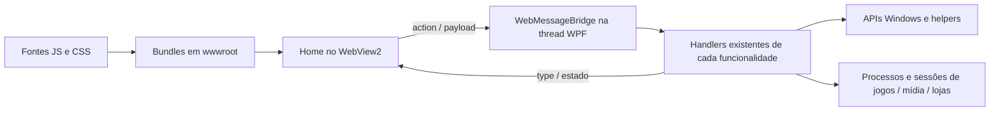

# Mapa atual e fronteiras de organização

## O que este mapa representa

Leitura estrutural da solução, extrações e evoluções autorizadas de permissões e
boot. O framework e o caminho de boot padrão foram preservados. O índice completo de arquivos e localizações
está em [current-inventory.json](current-inventory.json). As responsabilidades abaixo
foram agrupadas para navegação e planejamento; não representam todos os fluxos
como já auditados ou desacoplados.

## Projetos e processos existentes

| Projeto | Papel | Dependência e cuidado de ciclo de vida |
| --- | --- | --- |
| `Doorpi` | Host WPF, frontend WebView2, sessões, dispositivos, armazenamento e lançamento | Principal ponto de acoplamento; muitas responsabilidades continuam em partials de `MainWindow` |
| `DoorpiInputBridge` | Helper elevado para entrada em aplicativos que exigem esse contexto | Pipe e consentimento; preservar contexto de usuário e regras de encerramento |
| `DoorpiWindowsUpdateHelper` | Operações auxiliares de atualização do Windows | Não incorporar silenciosamente ao frontend ou alterar elevação |
| `DoorpiUpdater` | Aplicação externa de atualização e rollback do Doorpi | Precisa coordenar liberação de arquivos, relançamento e saúde da versão |
| `Doorpi.UpdateCore` | Manifestos, confiança, verificação, download, extração, planejamento e instalação | Já possui separação própria; incluir na revisão sem confundir com atualização Windows/GPU |
| `Doorpi.Boot.Tests` | Harness de sinais e supervisão do boot | Processos do próprio harness; não demonstra um logon real |
| `Doorpi.Browser.Tests` | Harness de política, store e coordenação de permissões | Testes isolados; não acessa câmera/microfone reais |

Bootstrap e interface principal atualmente podem ser dois processos do projeto
Doorpi. O bootstrap não cria outro frontend Chromium. Há um caminho direto
experimental, com a mesma preparação de Explorer e apresentação existente, para
comparação no PC lento. O padrão continua supervisionado; a necessidade de
preservar o segundo processo depende de medição. Ver
[comparação controlada](bootstrap-comparison.md).

## Responsabilidades nativas e fontes correspondentes

Os caminhos desta tabela são relativos ao projeto `Doorpi`, salvo indicação.

| Área | Fontes atuais principais | Fronteira a consolidar / situação |
| --- | --- | --- |
| Entrada na aplicação, instância e sessão | `App.xaml.cs`, `App.Bootstrap.cs`, `App.DirectStartup.cs`, `Boot/*`, `DoorpiBootDiagnostics.cs` | Seleção experimental, supervisão, handoff antes do mutex e diagnóstico; padrão supervisionado |
| Preparação e apresentação inicial | `BootIntroWindow.xaml/.cs`, `BootIntroWindow.Focus.cs`, `MainWindow.BootLifecycle.cs`, `MainWindow.StartupFocus.cs`, `MainWindow.xaml.cs` | Handoff da intro e proteção temporária de foco até a primeira tela interativa; não comprovam prontidão gráfica |
| Janela, escala, foco e ciclo principal | `MainWindow.xaml/.cs` | Continua concentrando modelos, campos, startup e muitos fluxos; ainda pendente |
| Comunicação home–host | `MainWindow.WebMessageBridge.cs` | Transporte, origem e roteamento legado isolados fisicamente; regras de negócio ainda dependem da janela |
| Configuração do runtime web | `Browser/WebViewRuntimeArguments.cs` | Primeira extração independente: configura argumentos sem criar WebView ou depender de WPF |
| Jogos e aplicativos externos | `MainWindow.Sessions.cs`, `LaunchCommand.cs`, `MainWindow.xaml.cs` | Estados, processos, janelas, monitoramento e retorno; não unificar categorias sem revisar diferenças |
| Home durante gameplay | `MainWindow.GameplayBackground.cs` | Suspensão/retomada e diário de sessão; preservar recuperação de tempo e estado |
| Controle global e troca de aplicativos | `XInputControllerHub.cs`, `MainWindow.ControllerShortcuts.cs`, loops em `MainWindow.xaml.cs` | Aquisição, atalhos, arbitragem de entrada e ação no app em primeiro plano |
| Perfis e bindings de controle | `ControlConfigurationModels.cs`, `MainWindow.ControlConfiguration.cs` | Modelo e configuração; captura/editor e runtime ainda interagem com a janela |
| Entrada elevada | `MainWindow.InputBridge.cs`, projeto `DoorpiInputBridge` | Não confundir com autorização para operar todos os contextos de Windows/UAC |
| Teclado virtual nativo | `DesktopVkbWindow.cs`, integração em `MainWindow` | Arquivo com alteração independente já presente; não foi editado nesta rodada |
| Apps web e navegador | `MainWindow.WebApps.cs` | Janelas, popups, navegação, input, sessão e scripts injetados ainda misturados |
| Perfis Chromium e cookies | `MainWindow.WebViewProfiles.cs` | Identidade por usuário/app, UDFs e persistência; preservar separação e revisar migrações antes de mudar limpeza |
| Trailers da home | `MainWindow.HomeTrailer.cs`, `TrailerExtension/*`, frontend `renderer` | Extensão limpa UI do player e desenha fundo; reinstalação por abertura tem motivo histórico desconhecido |
| Downloads do navegador | `MainWindow.BrowserDownloads.cs` | Pasta do usuário, apresentação e ciclo de download |
| Integração SMTC e user agent | `MainWindow.Modules.cs` | Permissões foram extraídas; UA e mídia Windows continuam pendentes de separação |
| Permissões web | `Browser/BrowserPermission*`, `MainWindow.WebPermissions.cs` | Política/store/coordenação independentes; adaptador WPF/WebView e confirmação nativa separados |
| Histórico de mídia | `MediaActivityHistory.cs`, trackers em `MainWindow.WebApps.cs` | Separar normalização/persistência de observação do site, mantendo compatibilidade |
| Biblioteca, cache e artwork | `GameModel.cs`, `MainWindow.xaml.cs` | Descoberta de plataformas, reconciliação, imagens e edição ainda concentradas |
| Emuladores e discos | `MainWindow.Emulators.cs` | Preservar resolução de comandos, seleção e vínculo com sessões |
| Lojas e instalação | `MainWindow.Stores.cs`, `MainWindow.StoreDownloads.cs`, `StoreDownloadWindow.cs` | Fluxos próprios, cancelamento, instalação e retomada; não tratar como simples navegação web |
| Arquivos internos e abertura | `MainWindow.FileBrowser.cs`, `MainWindow.FileExplorerLaunch.cs` | UI interna, seleção, execução e acompanhamento são responsabilidades distintas |
| Armazenamento e desinstalação | `MainWindow.Storage.cs` | Scan, cache, UI e acompanhamento de desinstaladores |
| Wi-Fi | `WifiManager.cs`, `MainWindow.Wifi.cs` | Serviço existente e adaptação de mensagens para UI |
| Bluetooth | `BluetoothManager.cs`, `MainWindow.Bluetooth.cs` | Rádio, descoberta, pareamento, consentimento e adaptação UI |
| Som e dispositivos | `SoundManager.cs`, `MainWindow.Sound.cs` | Dispositivos/sessões Windows e volumes internos do frontend são camadas diferentes |
| GPU e recuperação do WebView | `GpuUpdateManager.cs`, `MainWindow.GpuUpdates.cs` | Atualização de driver e recuperação do browser dividem arquivo; separar depois de revisar contexto |
| Windows Update | `WindowsUpdateManager.cs`, `MainWindow.WindowsUpdates.cs`, helper externo | Preservar autorização, progresso, reinício e recuperação |
| Atualização do Doorpi | `MainWindow.Updates.cs`, `DoorpiUpdater`, `Doorpi.UpdateCore` | Handoff de processos, aplicação, rollback e confirmação de saúde |
| Usuários, autenticação e sincronização | `MainWindow.xaml.cs`, `MainWindow.ProfileSync.cs`, `ProfileSync/*` | Dados locais, OAuth, Drive, serialização e UI já parcialmente separados |
| Fotos de perfil | `MainWindow.ProfilePhotos.cs` | Fontes, tratamento e vínculo com usuário |
| Arquivos e diretórios persistidos | `DoorpiPaths.cs`, `DurableFileStore.cs`, stores específicos | Não criar um serviço único genérico que esconda diferenças de formato e durabilidade |
| Integração Discord | `DiscordRpcManager.cs` | Recurso opcional; revisar início/atualização/encerramento sem bloquear UI |
| Metadados e build | `AssemblyInfo.cs`, projetos, `scripts/*`, `installer/*`, `manifests/*` | Parte do inventário; preservar cópia de assets, atualizações e restauração de shell |

Essas são fronteiras propostas, não autorização para excluir caminhos legados.
Um arquivo partial menor continua usando os campos e o dispatcher da mesma janela.
A extração de serviços de verdade requer revisar proprietário do estado, chamadas,
eventos, cancelamento e tempo de vida.

## Cobertura dos 19 bundles do frontend

Fontes em `Doorpi/Frontend/scripts`; saídas em `Doorpi/wwwroot`.

| Bundle | Partes atuais | Papel |
| --- | ---: | --- |
| `app.js` | 38 | Estado, áudio, perfis, sessões, bridge, overlays, edição e transições |
| `bluetooth-ui.js` | 1 | Apresentação/ações Bluetooth |
| `controls.js` | 15 | Editor, captura e configuração de controles |
| `emulators.js` | 1 | Apresentação e configuração de emuladores |
| `file-browser.js` | 1 | Navegador interno de arquivos |
| `grid-controller.js` | 1 | Integração de grade e controle |
| `intro-system.js` | 8 | Configuração, preparação, handoff, entrada, mensagens, startup e API da intro |
| `media.js` | 1 | Catálogo/apresentação de mídia e apps integrados |
| `nav-menu.js` | 30 | Navegação e configuração por área, incluindo permissões |
| `navigation.js` | 12 | Foco espacial, teclado, entrada e despacho de controle |
| `profile-photo-picker.js` | 1 | Escolha e tratamento visual de foto |
| `profile-sync-ui.js` | 1 | Fluxos de sincronização |
| `renderer.js` | 5 | Cards, destaque, trailers e apresentação de artwork |
| `setup.js` | 11 | Configuração inicial, formulário, autenticação e ciclo de apresentação |
| `sound-ui.js` | 1 | Interface de dispositivos e som |
| `store.js` | 1 | Estado compartilhado `AppStore` de jogos/mídia/lojas; não é a aba Lojas |
| `stores.js` | 1 | Aba Lojas, menus e bridge de sessão |
| `strings.js` | 1 | Traduções |
| `wifi-ui.js` | 1 | Apresentação/ações Wi-Fi |

São fragmentos ordenados para concatenação. Não são módulos ES independentes nem
serviços com estado isolado. Fontes pequenas ainda podem estar acopladas a globais.
CSS principal: 22 fragmentos. CSS literal injetado: 40 blocos. Estilos inline,
templates interpolados, CSSOM, scripts injetados por C# e os pacotes de intro
continuam na fila de revisão.

## Comunicação e ordem de execução

O handler aceita mensagens string e objeto, valida a origem, lê `action` e primeiro
delega permissões, sincronização, configuração de controle e navegador de arquivos. O
roteamento posterior mantém os `if/else`, seus retornos e tarefas existentes.
Não foi convertido automaticamente em dicionário ou dispatch paralelo: isso poderia
alterar fallthrough, ordem, lifetime de `JsonDocument` e contexto do dispatcher.

Na próxima revisão, cada grupo deve registrar entradas, saídas, efeitos colaterais,
perfil/usuário, thread e cancelamento. Os 645 candidatos literais do inventário
incluem comparações e switches auxiliares; **não significam 645 comandos válidos**.

## Dúvidas e decisões abertas

- Por que a extensão de trailer precisa ser reinstalada a cada startup? O autor não
  recorda. Sua função visual foi identificada; o workaround permanece.
- Política de câmera/microfone está implementada e descrita em `web-permissions.md`;
  integração com dispositivos reais, foco e consentimentos do SO ainda requer validação.
- O bootstrap ainda altera o resultado em uma máquina lenta, com a mesma build e
  runtime? Falta experimento controlado; nenhuma conclusão de remoção.
- Limpezas de perfis e caches têm quais invariantes de recuperação e compatibilidade?
  Revisar schema, dados e processos em uso antes de torná-las assíncronas ou removê-las.
- Tokens de tema devem ser extraídos preservando valores e cascata. Agrupar cores
  visualmente parecidas não prova que devem compartilhar o mesmo token.

## Fora da validação desta rodada

Logon real, GPU em máquina lenta, navegação interativa em todas as telas,
consentimentos do Windows, mudança de usuário, jogo ativo durante crash, atualização
completa e rollback. Compilar e preservar os bundles não certifica esses cenários.
