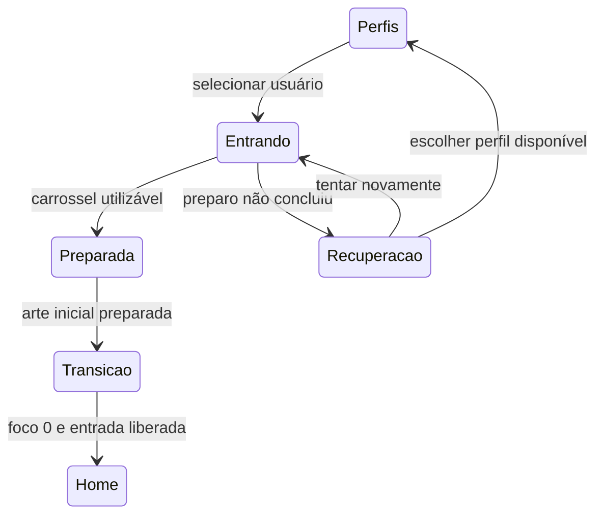

# Login e Home — 10 de novembro de 2026

Decisões alinhadas: reutilizar **Entrando**, preparar o carrossel por trás da tela,
liberar a navegação só após o crossfade e entregar foco à região 0. As horas totais
permanecem na Home. Referência de escala: 2560×1440, Windows a 100%.

## Fluxo

`getEntryTarget('home')` resolve o alvo sem focá-lo. A Home pode ser composta com
`inert` ativo. A espera verifica a aba corrente, itens utilizáveis e o estado de
carregamento. A fila registra o lote real de `renderGames`, seu perfil e sua
identidade; o Store encaminha uma confirmação que o GridController só executa
depois de `CardRenderer.syncDOM`. Limpar a grade e deixar Adicionar disponível
não confirma o carregamento. Uma biblioteca só é vazia quando o lote confirmado
contém zero jogos. Se todos aguardam arte estática, Entrando permanece visível.
Temas são aplicados antes dessa avaliação.

Antes do login, a ponte descarta mensagens de composição da biblioteca. O host já
protege os envios de jogos/mídia pela sessão interativa; a proteção da ponte também
evita gerar fallbacks, imagens e esqueletos prematuramente. O ambiente animado da
Home é criado apenas após a seleção, e fica oculto ao voltar aos perfis. A consulta
inicial de atualizações de extensões foi transferida do temporizador do boot para
o fim do login, com validação do perfil antes do envio.

O alvo é revelado na rolagem ainda por trás de Entrando. Nome, contexto, horas e
arte estática são preparados sem ativar a navegação. Imagens visíveis têm uma espera
curta e limitada; downloads de outras abas não bloqueiam a entrada.

O crossfade mantém a entrada bloqueada. Depois há foco confirmado no carrossel,
liberação de `inert`, retomada do áudio e `doorpiHomeInteractiveReady`. O aviso de
atualização é reavaliado após a liberação. Não há observador que tente recuperar o
foco alguns segundos depois de mostrar a Home.
O ambient da seleção sai junto com o crossfade, em 320 ms; não permanece sobre a
Home liberada. Os demais usos de `finishHandoff` mantêm os 900 ms originais.

Cada entrada captura o perfil e uma versão de transição. Nova seleção ou liberação
explícita invalida a anterior. Verificações após `await` impedem uma conclusão
antiga de liberar a sessão seguinte.
O lote também é invalidado na troca de sessão; uma fila antiga não pode confirmar
o preparo do perfil seguinte. Selecionar o perfil já ativo reaproveita o lote,
mas passa por Entrando quando ele ainda não foi composto. Os cards preparados
nessa etapa não recebem a animação adicional de entrada em lote.

Se não há alvo após oito segundos de avaliação, Entrando muda para recuperação e
mantém a Home protegida. Tentar novamente repete o preparo; Escolher perfil aparece
quando a lista já está disponível. Falha não cria uma biblioteca vazia nem grava
preferências. Exclusão que retorna ao seletor obrigatório mantém seu caminho.

## Auditoria visual

| Elemento | Tratamento |
| --- | --- |
| Moldura horizontal e fundo do jogo | O fundo vira o destaque; a moldura permanece no DOM como fallback e para layouts explícitos dos temas. |
| Logo, nome e origem | Preservados, agrupados à esquerda. |
| Em execução, novo e bloqueado | Preservados no contexto do jogo. |
| Tempo total | Mantido abaixo do nome/contexto; última sessão retirada da Home, preservada nos dados. |
| Cards | Proporção 2:3 e comandos preservados. |
| Painel rápido | Ações e ícones preservados; texto contextual solto e descrições ocultas removidos a pedido. |
| Foco do perfil na Home | Anel restrito ao avatar, sem contornar nome, menu ou notificações. |
| Informações durante o trailer | Mesma composição da Home; painel compacto reservado ao modo cinema. |
| Saída do carrossel | Fundo e logo da última seleção permanecem; a indicação de Jogar fica invisível, sem deslocar a composição. |
| Texto dos cards | Nome visível no card focado; capas e nomes acessíveis permanecem no DOM. |
| Legenda acima do logo | Oculta no tema padrão; disponível aos temas pelo contrato existente. |
| Contador do carrossel | Retirado da Home. A biblioteca completa usa a contagem do snapshot integral; busca e filtros mostram resultados em relação ao total. O fallback do carrossel não é apresentado como total da coleção. |
| Login | Entrando, sem texto técnico de preparo. Falhas continuam oferecendo recuperação. |
| Notificação de extensões | Fecha as notificações e abre Extensões após a abertura do menu, sem temporizador fixo ou restauração de foco sobre a nova tela. |
| Saída da intro | O logo Neon termina diretamente na seleção preparada, com dissolve de 180 ms também no skip. A tela de perfis usa fundo estático, sem novo voo de blobs. |

Com menos texto, a composição padrão dá maior presença ao logo e ao nome. As horas
totais ficam abaixo da identificação, sem o bloco de última sessão. Os limites de escala continuam
nos tokens públicos; a apresentação compacta reduz logo e espaçamento em telas
baixas. Ocultar Jogar preserva seu espaço para evitar saltos ao navegar no cabeçalho.

A referência é a organização por contexto descrita pelos [designers do YouTube para TV](https://blog.youtube/news-and-events/designing-a-richer-youtube-experience-for-your-tvs/)
e a continuidade entre sistema e jogo na [Sony Design/PS5](https://www.sony.com/en/SonyInfo/design/stories/PS5/).
Nenhuma estatística foi transferida para uma tela de detalhes nesta etapa.

## Fontes e verificação

- `app/270-session-transition.js`: preparo, invalidação, crossfade e recuperação.
- `navigation/015-region-contract.js`: resolução e entrega de foco na região 0.
- `app/180-artwork-and-hero.js`: opção explícita para preparar arte durante a
  transição; as demais chamadas continuam bloqueadas nesse estado.
- `features/home/100-default-composition.css`: composição padrão. Layouts explícitos
  dos temas e os tokens públicos de tipografia continuam ativos.
- `features/110-launch-overlay.css`: Entrando e recuperação.

O harness `Render-ConsoleSurfaces.cjs` exercita fila, Store, GridController e renderer
reais: lote atrasado com Adicionar já presente, vazio confirmado, arte estática
pendente, perfil ativo ainda em preparo, falha/retentativa e perfil invalidado.
Também cobre cinco resoluções, a intro Neon real e estabilidade do bloco de
informações ao iniciar o trailer. A revisão
da Home usa markup e renderer reais; artes opcionais são cópias de cache em
`artifacts`, com horas fictícias. Não é uma sessão real do usuário.

`Render-ThemePreview.cjs` cobre seleção, temas, escopos e trailer. A comparação
histórica da extração é optativa, por `DOORPI_THEME_BASELINE_CSS`: a composição
padrão foi alterada de forma autorizada e não é igual ao CSS anterior. A abertura
do menu só conclui após selecionar a categoria no RAF: isso impede a composição
pendente de substituir o destino de Extensões acionado pela notificação. O teste
usa o clique real da notificação e o menu completo; também verifica o botão de
Extensões nas configurações, que já funcionava.

Verificação local concluída em 12/11/2026: fluxo completo com a intro real no
Chromium isolado, cinco resoluções, igualdade da geometria das informações antes
e durante o trailer, 47 casos de temas/rotas e build Release sem avisos/erros. Capturas
e relatório ficam em `artifacts/console-surfaces` e `artifacts/theme-preview`.

Pendentes: WebView2/TV/controle físico, atmosfera e demais telas. Não foram alterados
SQLite, migrações, Explorer ou seleção de bootstrap. Não foi gerado instalador,
pacote de atualização ou manifesto de produção.

## Ajuste de entrada e primeira abertura — 14/11/2026

O pacote Neon não mantém mais dois segundos de blobs após o acento final do logo.
Quando a seleção já está composta, o host prepara seu fundo com opacidade integral
antes de dissolver o iframe em 180 ms. Pular usa a mesma passagem; movimento
reduzido remove o fade. A reabertura pela Home continua imediata, sem recriar a intro.

Após a prontidão da Home, ainda sob Entrando, `prepareDoorpiNavMenuEntry` lê somente
o índice de jogos e prepara o primeiro lote de até 40 slots, com imagens limitadas
à área visível. O índice ainda contém os metadados da coleção completa; não se trata
de paginação de dados no backend. Não há leitura de histórico/configurações nem
montagem da grade de aplicativos nesse preparo. A leitura pode ser abortada após
900 ms, e a espera opcional por imagens tem limite de 400 ms. Falhar no preparo
mantém o caminho normal de abertura, sem impedir o login.

A operação valida perfil, revisão do menu e geração da sessão antes de confirmar
dados. Não abre o menu nem transfere foco. Slots restantes são montados em lotes
ociosos somente com a categoria aberta, depois da transição; suas artes continuam
carregadas por proximidade da rolagem. Geometria é lida antes de inserir imagens,
e elementos ocultos com tamanho zero não contam como visíveis. A composição inicial
e o início do movimento agora ficam em quadros separados.

Os harnesses verificam intro/skip reais, preparo limitado, reuso dos cards,
preservação do foco e descarte de sessão invalidada. Isso valida comportamento em
Chromium isolado; não comprova FPS, uso de GPU ou ausência de stutter no WebView2.
